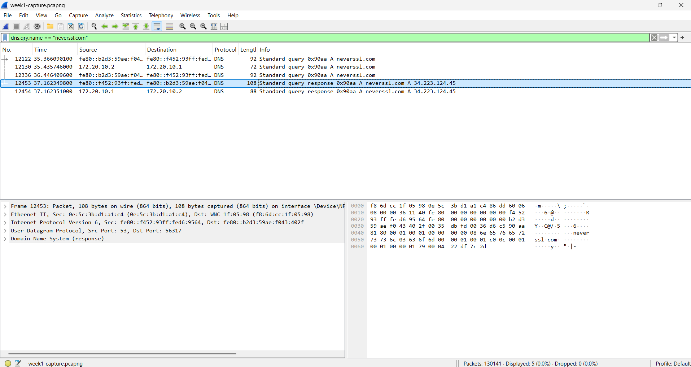
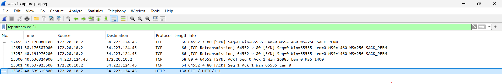
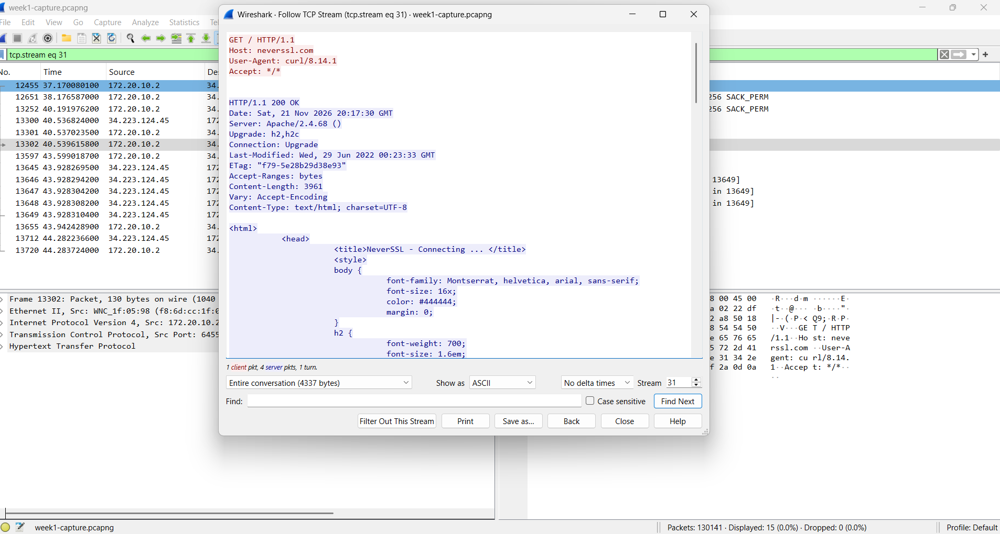
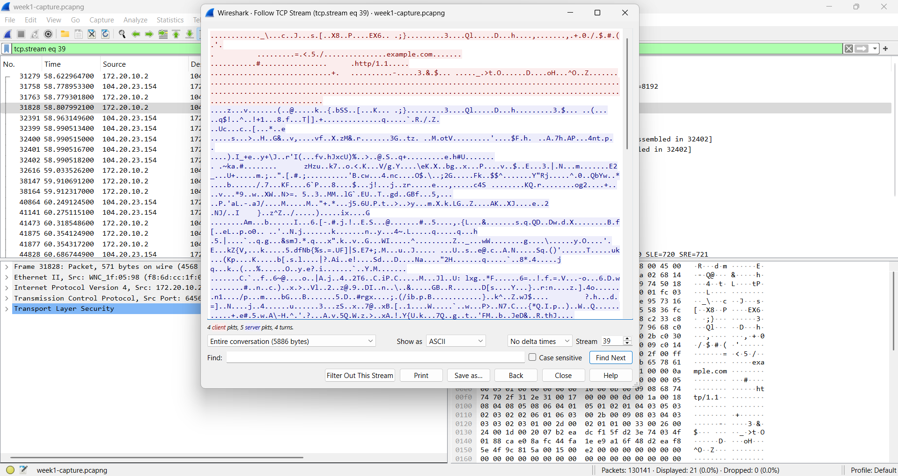

# Week 1: My First Packet Analysis

- **Date:** 21 November 2026
- **Tools:** Wireshark, curl (Windows Command Prompt)
- **Capture file:** `week1-capture.pcapng` (kept private, since it contains my own network traffic)

## Summary
I captured my laptop's network traffic while loading a plain-HTTP website (neverssl.com) and an HTTPS website (example.com), then traced the DNS lookup, the TCP handshake and the web request. The HTTP traffic was completely readable. The HTTPS traffic was encrypted, except for the website's name.

## What I did
1. Started a Wireshark capture on my Wi-Fi.
2. Ran `curl http://neverssl.com` and `curl -I https://example.com` in Command Prompt.
3. Stopped the capture and used display filters to find each step.

## 1. DNS lookup
**Filter:** `dns.qry.name == "neverssl.com"`

My laptop (172.20.10.2) asked my router (172.20.10.1) for the address of neverssl.com. The answer was an **A record (IPv4): 34.223.124.45**. My laptop asked the same question three times, over both IPv4 and IPv6, and every answer gave the same address.

## 2. TCP handshake
**Filter:** `tcp.stream eq 31`

My laptop connected to 34.223.124.45 on port 80 in three steps:
1. `[SYN]` my laptop: "can we talk?"
2. `[SYN, ACK]` the server: "yes, can you hear me?"
3. `[ACK]` my laptop: "yes!"

Straight after the handshake, my laptop sent its web request (`GET / HTTP/1.1`). Once the page had arrived, both sides closed the connection with `[FIN, ACK]`.

## 3. Readable web request (HTTP)
**How:** right-click the `GET` packet → Follow → TCP Stream

Because neverssl.com uses plain HTTP, I could read the whole conversation:
- **My request:** `GET / HTTP/1.1` to neverssl.com, sent by `curl/8.14.1`
- **The reply:** `HTTP/1.1 200 OK` from an Apache web server, followed by the page's HTML

Anyone between me and the server could read this too. That's why HTTPS matters.

## 4. Encrypted web request (HTTPS)
**Filter:** `tls.handshake.extensions_server_name == "example.com"`

When I followed the HTTPS stream to example.com, almost everything was scrambled. I could still see the server's IP address (104.20.23.154) and the site name "example.com" in the Client Hello, which is sent before encryption starts. I could not see my request or the page that came back. Someone watching the network can tell which website I visited, but not what I did there.

## Something unexpected
My laptop's first `[SYN]` got no reply, so it sent it twice more, about 1 second and then 2 seconds later, before the server answered. My GET request was also sent twice. Wireshark marks these as "TCP Retransmission": some packets were lost on the way, and TCP noticed and sent them again automatically.

With the filter `tcp.analysis.flags`, I also saw Keep-Alive and Window Update messages from other apps. These are normal TCP housekeeping, not errors.

In an earlier capture, I noticed my antivirus (Avast) requesting my router's admin page over plain, unencrypted HTTP. Background software talks on the network all the time, and an analyst has to recognise it.

## Filters I used
| Filter | What it shows |
| --- | --- |
| `dns.qry.name == "neverssl.com"` | DNS questions and answers for one website |
| `http.host == "neverssl.com"` | Web requests to one website |
| `tcp.stream eq 31` | One complete TCP conversation |
| `tls.handshake.extensions_server_name == "example.com"` | The start of an encrypted connection to one website |
| `tcp.analysis.flags` | Packets Wireshark flags, such as retransmissions |

## What I learned
- DNS turns a website's name into an IP address, and I can watch that question and answer on the network.
- Every TCP connection starts with SYN, SYN-ACK, ACK, and TCP re-sends packets when replies don't arrive.
- Plain HTTP can be read by anyone along the way. HTTPS hides the content, but not which site you visited.
- Most traffic on a laptop comes from background apps, so filters are essential for finding what matters.
